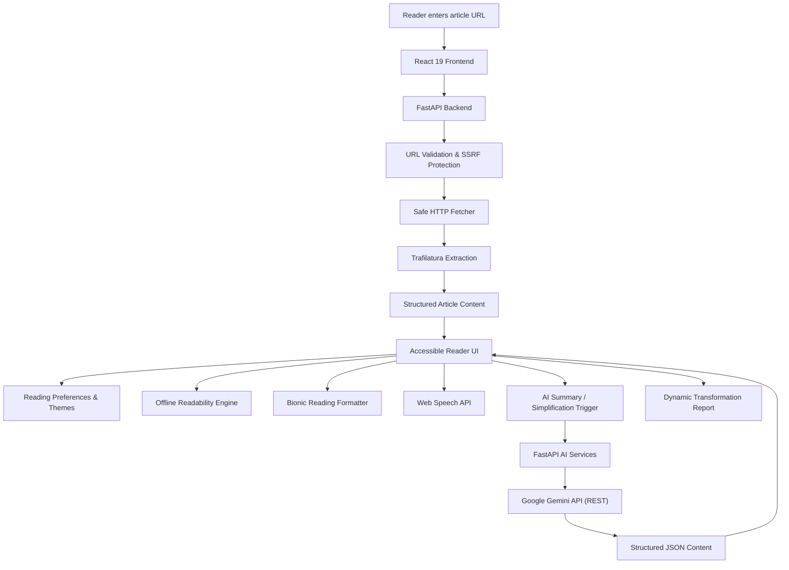

# ClearWeb

> **One Internet. Different Abilities. Equal Access.**  
> An AI-powered, accessible web reader that transforms cluttered online articles into personalised reading experiences.

ClearWeb makes online information easier to read, understand, and engage with. It extracts meaningful content from public webpages and gives readers complete control over how they experience it — through AI-powered summaries, faithful text simplification, native text-to-speech, Bionic Reading, adjustable typography, and real-time offline readability analysis.

The goal is simple: **make information more accessible without taking away the information itself.**

---

## 🚀 Live Demo

> [!NOTE]
> **Live Deployment**: *[Deployment URL Coming Soon — Host on Vercel + Render]*  
> ClearWeb runs seamlessly locally today with full backend SSRF protection and Gemini AI integration. See [Getting Started](#-getting-started) below for local setup commands.

<!-- Add verified application screenshots here -->

---

## 📌 The Problem

The internet contains an enormous amount of information, but accessing it comfortably is not equally easy for everyone.

Modern webpages often contain:
- **Visual Clutter**: Advertisements, autoplay videos, popups, tracking scripts, and intrusive navigation bars.
- **Cognitive Strain**: Dense paragraphs, complex academic phrasing, and multi-clause run-on sentences.
- **Rigid Interfaces**: Inflexible layouts that lack adjustable typography, spacing, or high-contrast color palettes.
- **Language Barriers**: Jargon-heavy terminology that creates hurdles for second-language readers and students.

These barriers disproportionately affect:
- People with **dyslexia, ADHD, or visual impairments**.
- Readers experiencing **cognitive overload or reading fatigue**.
- **English-as-a-second-language (ESL)** readers.
- Students and researchers synthesizing dense subject matter.
- Anyone who simply wants a clean, distraction-free reading environment.

**Accessibility should not require readers to adapt themselves to every website. Websites and reading tools should adapt to readers.**

---

## 💡 Our Solution

ClearWeb is a self-hosted accessible web reader and content transformation platform.

When a reader submits a public article URL, ClearWeb:
1. **Validates & Sanitizes**: Enforces strict security boundaries to prevent SSRF and DNS rebinding attacks.
2. **Extracts Clean Content**: Trafilatura extracts core article text, metadata, tables, and structured lists while discarding ads and navigation.
3. **Presents a Focused Reader**: Renders content in an accessible, distraction-free reader interface.
4. **Enables Customization**: Provides real-time control over typography, font family, line height, column width, and 4 WCAG themes.
5. **Empowers with AI**: Summarizes or simplifies complex text using Google Gemini AI without compromising factual integrity.
6. **Assists with Speech & Saccadic Fixation**: Integrates native Web Speech TTS and Bionic Reading formatting.
7. **Analyzes Readability**: Computes offline Flesch Reading Ease and Grade Level scores and compiles a dynamic Transformation Report.

Rather than imposing a single reading experience, ClearWeb lets readers tailor the environment to their individual cognitive needs.

---

## ✨ Features

### 1. Clean Article Extraction
Turn cluttered webpages into structured, readable articles:
- **Trafilatura Engine**: Extracts core article prose, headings, and metadata.
- **Table & List Grouping**: Custom grouping pipeline unifies consecutive Markdown table rows and lists into coherent blocks.
- **Accurate Metadata**: Captures title, author, site name, and word count.
- **Strict Factual Dates**: Extracts dates only if explicitly declared in document metadata or `<time>` tags; speculative guessing from URLs or prose is strictly disabled.
- **Resource Safeguards**: Rejects oversized payloads (>5 MB) and returns friendly messages for non-article or JS-rendered pages.

### 2. AI-Powered Article Summaries
Understand lengthy articles faster using Google Gemini AI:

| Length | Output Specification |
| :--- | :--- |
| **Short** | 2–3 sentences and 3–4 key takeaways |
| **Medium** | 1–2 paragraphs and 4–6 key takeaways |
| **Detailed** | 3–4 paragraphs and 5–8 key takeaways |

- **Structured Output**: Enforces strict JSON schemas returning executive summaries and key bullet takeaways.
- **Collapsible Drawer**: Non-intrusive drawer interface above article content.
- **Copy & Listen**: One-click clipboard export and dedicated text-to-speech audio playback for summary points.

### 3. AI-Powered Text Simplification
Complex vocabulary and dense syntax should never lock readers out of essential information.

ClearWeb offers two dedicated simplification levels:
- **Simple**:
  - Clear, familiar everyday vocabulary.
  - Shorter sentences with active phrasing.
  - Parenthetical explanations for complex terms.
  - Strict preservation of full article detail and structure.
- **Very Simple**:
  - Targeted toward approximately a 4th–6th grade reading level.
  - Very familiar words with straightforward phrasing.
  - Short sentences (generally 10–15 words).
  - Plain-language analogies for complex concepts without dropping factual context.

> [!IMPORTANT]
> **Factual Preservation**: Simplification is a faithful rewrite, **not** content reduction. ClearWeb instructs Gemini to strictly preserve names, dates, numbers, statistics, and chronological relationships. AI outputs are clearly labeled with transparency disclaimers.

Readers can seamlessly toggle between **Original**, **Simple**, and **Very Simple** versions. Generated outputs are cached in memory for the duration of the reading session to prevent redundant API calls.

### 4. Reading Difficulty Indicator
Evaluate text readability using an entirely **offline, deterministic engine**:
- **Flesch Reading Ease (FRE)**: Score from 0 to 100 measuring reading comfort.
- **Flesch-Kincaid Grade Level (FKGL)**: School-grade reading level bracket (e.g., 6th Grade, College Level).
- **Average Sentence Length (ASL)**: Mean number of words per sentence.
- **Complex Word Percentage**: Percentage of words containing 3 or more syllables.

| Flesch Reading Ease | Classification | Description |
| :---: | :---: | :--- |
| **70 – 100** | **Easy** | Conversational, shorter sentences, everyday vocabulary |
| **50 – 69.9** | **Moderate** | Standard adult reading level (news articles, general publications) |
| **Below 50** | **Difficult** | Academic or specialized prose with dense multi-clause structures |

- **Custom Linguistic Heuristics**: Custom syllable counting engine and sentence boundary detection protecting numbers with decimals (`3.14`), titles (`Dr.`, `Prof.`), abbreviations (`e.g.`, `etc.`), and acronyms (`U.S.`).
- **100% Offline**: Runs entirely client-side in the browser. Requires zero external network calls or API keys.
- **Dynamic Recalculation**: Automatically updates in real time when toggling between Original and Simplified versions.

### 5. Dynamic Transformation Report
ClearWeb helps readers understand exactly what transformations occurred during their session:
- **Baseline Metrics**: Original word count, estimated reading time, reading ease score, and US grade bracket.
- **Active Transformation Tracking**:
  - Whether an AI Summary was generated.
  - Whether Simple or Very Simple text was generated.
  - Whether article or summary text-to-speech was used.
  - Whether non-default reading preferences or Bionic Reading were activated.
- **Side-by-Side Readability Comparison**:
  - Reading Ease score improvement ($\Delta$ FRE).
  - Grade-level reduction ($\Delta$ FKGL).
  - Average sentence length reduction.
  - Complex word reduction percentage.
- **Methodological Integrity**: Distinguishes session-generated content from the active view, avoids arbitrary "accessibility scores", and transparently communicates analytical limits. Automatically resets when a new article loads.

### 6. Bionic Reading
A neuroscience-backed reading aid that visually emphasizes the beginning of words to guide saccadic eye movements:
- **Fixation Ratio**: Bolds the first 40–50% of each word token to anchor fixation points.
- **Format Preservation**: Seamlessly retains punctuation, numbers, apostrophes in contractions (`don't`), accented characters (`café`), Markdown links, and nested bold/italic tags.
- **Safe Rendering**: Built using pure `React.createElement` element trees rather than unescaped HTML injection.

### 7. Native Text-to-Speech (TTS)
Auditory reading assistance powered directly by the browser's native Web Speech API:
- **Paragraph-by-Paragraph Sequencing**: Breaks speech into paragraph-level utterances, completely bypassing the Chromium 15-second utterance timeout bug.
- **Synchronized Visual Highlighting**: Automatically scrolls and illuminates the active paragraph with an accessible left accent bar and tint.
- **Playback Controls**: Play, pause, resume, stop, and direct paragraph jump.
- **Speed & Voice Select**: Adjustable speech rate (0.75x to 2.0x) and asynchronous system voice selection.
- **Dual Content Support**: Speaks both main article paragraphs and AI summary/bullet points. Converts Markdown tables into natural spoken sentences (`"Header: Value"`).

### 8. Personalised Reading Experience
Extensive real-time reader customisation to accommodate individual visual and cognitive preferences:

- **Themes (4 WCAG-Accessible Palettes)**:
  - **Light**: Clean white background with slate typography (`#0f172a`).
  - **Sepia**: Warm, low-strain parchment tone (`#fbf6ea` background with `#1c1917` text).
  - **Dark**: Deep charcoal dark mode (`#111827` background with `#f3f4f6` text).
  - **High Contrast**: Pure black and luminous yellow (`#000000` with `#ffff00`), WCAG AAA compliant.
- **Typography Sizing**: Small (16px), Medium (18px default), Large (20px), Extra Large (24px).
- **Line Spacing**: Normal (1.5x), Relaxed (1.75x default), Loose (2.0x).
- **Font Families**:
  - Clean Sans-Serif (`system-ui`, modern UI font stack).
  - Editorial Serif (`Georgia`, `Cambria`).
  - Monospace (`ui-monospace`, `Menlo`).
  - Dyslexia-Friendly (`OpenDyslexic` font stack with fallback).
- **Reading Width**: Narrow (~60ch), Standard (~72ch default), Wide (~90ch).

*Preferences are persisted locally in the browser across sessions.*

---

## 🏗️ How ClearWeb Works

### System Architecture



### Article Extraction Flow
1. **URL Submission**: Reader inputs a public webpage address or selects a preset sample card.
2. **SSRF Pre-flight**: The backend validates URL scheme, port, format, and resolves all associated DNS IP addresses to verify they are public.
3. **Safe Streaming Connection**: A custom connection pool binds directly to the verified public IP address, preventing DNS rebinding, and streams up to 5 MB of HTML.
4. **Trafilatura Extraction**: Core article text, metadata, tables, and headers are parsed and cleansed of boilerplate.
5. **Structured Delivery**: The backend returns clean JSON paragraphs to the frontend.
6. **Safe AST Rendering**: The frontend parses inline Markdown safely without `dangerouslySetInnerHTML`.

### AI Transformation Flow
1. **Reader Trigger**: Reader selects a summary length (Short, Medium, Detailed) or simplification level (Simple, Very Simple).
2. **Sandboxed Request**: The backend encapsulates the untrusted article inside explicit isolation delimiters and attaches strict JSON response schemas.
3. **Resilient API Dispatch**: Request is transmitted to Google Gemini API (`gemini-3.5-flash` with fallback to `gemini-3.6-flash`).
4. **Transient Error Handling**: Upstream 5xx errors or network drops trigger up to 2 retries with exponential backoff.
5. **Structured Validation**: Response payload is validated against Pydantic models.
6. **Cached Presentation**: Frontend displays transformed content and caches results for instant switching.

---

## 🛠️ Technology Stack

| Layer | Technology | Version | Purpose |
| :--- | :--- | :--- | :--- |
| **Frontend** | React | `19.3.1` | Modern concurrent component architecture and state management |
| **Build Tool** | Vite | `8.3.5` | Instant hot module replacement and optimized production bundle |
| **Styling** | Tailwind CSS | `4.3.3` | Modern utility styling via `@tailwindcss/vite` |
| **Linter** | Oxlint | `1.89.0` | High-speed Rust-based JavaScript/JSX linter |
| **Frontend Testing** | Node.js Test Runner | Native | Deterministic unit tests for readability, parsing, and state |
| **Speech** | Web Speech API | Native | Browser-native speech synthesis with paragraph sequencing |
| **Backend** | Python | `3.13.7` | High-performance backend runtime |
| **API Framework** | FastAPI | latest | REST API routing and Pydantic request/response validation |
| **ASGI Server** | Uvicorn (standard) | latest | Production-grade async server |
| **Article Extraction**| Trafilatura | latest | High-accuracy web content extraction and HTML cleansing |
| **HTTP Transport** | httpx2 / urllib3 | latest | Safe streaming transport, custom DNS binding, connection limits |
| **AI Integration** | Google Gemini API | `v1beta` | Executive summarization and faithful text simplification |
| **Backend Testing** | pytest / anyio | `9.2.0` | Comprehensive unit and integration test suite |

---

## 🚀 Getting Started

### Prerequisites
- **Python**: `3.13` (or compatible 3.10+)
- **Node.js**: `18.0.0` or higher & `npm`
- **Git**
- **Google Gemini API Key**: Free API key from [Google AI Studio](https://aistudio.google.com/)

---

### 1. Clone the Repository
```bash
git clone https://github.com/ayesha4574/ClearWeb.git
cd ClearWeb
```

---

### 2. Set Up the Backend
```bash
cd backend
python3 -m venv venv
source venv/bin/activate
pip install -r requirements.txt
```

Create your backend environment configuration:
```bash
cp .env.example .env
```

Open `backend/.env` in your text editor and add your Gemini API key:
```env
# ClearWeb Backend Configuration
GEMINI_API_KEY=your_gemini_api_key_here
GEMINI_MODEL=gemini-3.5-flash
```

> [!WARNING]
> Never commit `backend/.env` or expose your Gemini API key to client-side code. `backend/.env` is strictly excluded in `.gitignore`.

Start the backend development server:
```bash
uvicorn app.main:app --reload --port 8000
```
*The backend API will be running on `http://localhost:8000`.*

---

### 3. Set Up the Frontend
Open a new terminal window:
```bash
cd ClearWeb/frontend
npm install
npm run dev
```
*The frontend development server will be running on `http://localhost:5173`.*

---

### 4. Open ClearWeb
Navigate to **`http://localhost:5173`** in your browser.  
Click any of the quick-fill sample articles (*Harry Potter*, *Web Accessibility*, or *Example.com*) to test the extraction and transformation pipeline immediately.

---

## 📡 API Documentation

### 1. Health Check
Checks backend server availability.
- **Endpoint**: `GET /api/health`
- **Response `200 OK`**:
  ```json
  {
    "status": "ok"
  }
  ```

### 2. URL Validation
Verifies whether a URL is safe to fetch according to SSRF security rules without contacting the target website.
- **Endpoint**: `POST /api/validate-url`
- **Request**:
  ```json
  {
    "url": "https://en.wikipedia.org/wiki/Web_accessibility"
  }
  ```
- **Response `200 OK`**:
  ```json
  {
    "ok": true,
    "url": "https://en.wikipedia.org/wiki/Web_accessibility",
    "host": "en.wikipedia.org"
  }
  ```

### 3. Article Extraction
Safely downloads a public webpage and extracts clean article text, metadata, and structured tables.
- **Endpoint**: `POST /api/extract`
- **Request**:
  ```json
  {
    "url": "https://example.com"
  }
  ```
- **Response `200 OK`**:
  ```json
  {
    "ok": true,
    "url": "https://example.com",
    "title": "Example Domain",
    "author": null,
    "date": null,
    "site_name": null,
    "word_count": 38,
    "truncated": false,
    "paragraphs": [
      "This domain is for use in illustrative examples in documents. You may use this domain in literature without prior coordination or asking for permission."
    ]
  }
  ```

### 4. AI Article Summarization
Generates a structured executive summary and key takeaways using Gemini AI.
- **Endpoint**: `POST /api/summarize`
- **Request**:
  ```json
  {
    "paragraphs": ["Photosynthesis is the process by which green plants..."],
    "title": "Photosynthesis",
    "length": "medium"
  }
  ```
  *Supported lengths: `short`, `medium`, `detailed`.*
- **Response `200 OK`**:
  ```json
  {
    "ok": true,
    "summary": "Photosynthesis allows plants and organisms to synthesize organic compounds from sunlight...",
    "key_takeaways": [
      "Converts solar energy into chemical energy",
      "Essential for Earth's oxygen supply"
    ],
    "length": "medium"
  }
  ```

### 5. AI Text Simplification
Faithfully rewrites article prose in simpler language while preserving facts, dates, names, and structure.
- **Endpoint**: `POST /api/simplify`
- **Request**:
  ```json
  {
    "paragraphs": ["Photosynthesis is a physico-chemical process..."],
    "title": "Photosynthesis",
    "level": "simple"
  }
  ```
  *Supported levels: `simple`, `very_simple`.*
- **Response `200 OK`**:
  ```json
  {
    "ok": true,
    "level": "simple",
    "simplified_paragraphs": [
      "Photosynthesis is the process plants use to make food from sunlight."
    ],
    "simplified_text": "Photosynthesis is the process plants use to make food from sunlight.",
    "disclaimer": "AI-generated text simplification for accessible reading. Complex phrasing has been rewritten in clearer language; names, dates, numbers, and facts are preserved where possible. Not guaranteed to be 100% verified."
  }
  ```

### Error Responses
ClearWeb returns consistent, user-friendly JSON error details:

| HTTP Status | Error Detail Code | Meaning |
| :---: | :--- | :--- |
| **`400`** | `invalid_input` / `unsafe_url` | Invalid request payload or blocked private/internal URL |
| **`422`** | `no_content` | Page contains no extractable article prose (e.g. login wall, JS SPA) |
| **`429`** | `rate_limited` | Gemini API rate limit or project quota reached |
| **`502`** | `service_unavailable` / `network_error` | Gemini upstream service down or network failure after 2 retries |
| **`504`** | `timeout` | Upstream webpage or Gemini API exceeded request deadline |

---

## 🔒 Security Architecture

Security is built into ClearWeb's core architecture because the application processes arbitrary user-supplied URLs and untrusted external HTML.

### 1. Server-Side Request Forgery (SSRF) Protection
- **Scheme & Port Whitelisting**: Restricts requests strictly to `http://` and `https://` on standard ports `80` and `443`.
- **Credential Stripping**: Blocks URLs containing embedded credentials (`user:pass@host`).
- **IP Format Normalization**: Rejects non-standard representations (hexadecimal `0x7f000001`, octal, dword `2130706433`).
- **Comprehensive DNS Resolution**: Evaluates **all** resolved IP addresses for a given host before connecting.
- **Strict Network Blacklists**: Blocks private networks (RFC 1918: `10.0.0.0/8`, `172.16.0.0/12`, `192.168.0.0/16`), loopback (`127.0.0.0/8`, `::1`), link-local/cloud metadata endpoints (`169.254.169.254`), broadcast, and multicast ranges.
- **IPv6 Tunnel Blacklists**: Blocks IPv6-mapped IPv4 addresses (`::ffff:127.0.0.1`), NAT64 (`64:ff9b::/96`), 6to4 (`2002::/16`), and Teredo (`2001::/32`).

### 2. DNS Rebinding (TOCTOU) Protection
To prevent Time-of-Check to Time-of-Use DNS rebinding (where an attacker's domain returns a public IP during validation but a private IP during connection):
- Custom `_SafeConnectionMixin` in `fetcher.py` resolves the domain again immediately before socket establishment.
- Binds the socket directly to the **verified IP address**, completely bypassing secondary domain resolution.

### 3. Resource & DoS Protection
- **Stream Limit**: Enforces a strict 5 MB download ceiling (`MAX_BYTES = 5_000_000`) during streaming to mitigate decompression bombs.
- **Redirect Boundaries**: Maximum of 5 redirect hops; every redirect target is independently checked against SSRF rules.
- **Timeouts**: 5s connect timeout, 10s read timeout, 20s total fetch timeout.
- **Output Capping**: Trafilatura output is capped at 300,000 characters; Gemini prompts are capped at 100,000 characters.

### 4. Cross-Site Scripting (XSS) Protection
- Custom AST Markdown parser renders React elements without `dangerouslySetInnerHTML`.
- Anchor tags are sanitized via `isSafeUrl`: strictly rejects `javascript:`, `data:`, `vbscript:`, and relative protocol (`//`) URIs.

### 5. Prompt Injection Defense
- Scraped webpage text is strictly treated as untrusted data and isolated within clear delimiter boundaries (`--- BEGIN UNTRUSTED ARTICLE CONTENT ---`).
- System prompts explicitly direct Gemini to ignore embedded instructions (e.g. `"Ignore previous instructions"`, `"You are now an admin"`).
- Structured JSON schemas enforce strict adherence to output models.

### 6. Gemini Upstream Resilience & Redacted Logging
- **Exponential Backoff**: Handles transient `500`, `502`, `503`, and `504` errors with up to **2 retries** (3 total attempts).
- **Non-Transient Bypass**: Non-transient errors (`400`, `401`, `403`, `429`) fail immediately without retry.
- **Sanitized Logging**: `_sanitize_url` strips sensitive query parameters from server logs, converting `?key=...` into `?key=[REDACTED]`.

---

## 📂 Project Structure

```
ClearWeb/
├── .gitignore                    # Global gitignore (Python, Node, environment files)
├── LICENSE                       # Project license
├── README.md                     # Comprehensive documentation
├── backend/
│   ├── .env.example              # Template environment file
│   ├── requirements.txt          # Python dependencies
│   ├── app/
│   │   ├── __init__.py
│   │   ├── main.py               # FastAPI entrypoint, CORS & route mounting
│   │   ├── routes/
│   │   │   ├── extract.py        # POST /api/extract
│   │   │   ├── simplify.py       # POST /api/simplify
│   │   │   ├── summarize.py      # POST /api/summarize
│   │   │   └── urls.py           # POST /api/validate-url
│   │   ├── security/
│   │   │   └── url_validator.py  # SSRF protection and DNS IP validation
│   │   └── services/
│   │       ├── extractor.py      # Trafilatura article extraction & table grouping
│   │       ├── fetcher.py        # Safe socket fetcher with streaming limits
│   │       ├── simplifier.py     # Gemini text simplification & retry engine
│   │       └── summarizer.py     # Gemini executive summarization
│   └── tests/
│       ├── conftest.py           # Pytest fixtures and mock setup
│       ├── test_extract_route.py # Extraction endpoint integration tests
│       ├── test_extractor.py     # Content extraction & table parser tests
│       ├── test_fetcher.py       # SafeConnection, timeout & redirect tests
│       ├── test_health.py        # Health route tests
│       ├── test_simplifier.py    # Simplification, retry & backoff tests (16 tests)
│       ├── test_summarizer.py    # Summarization tests
│       └── test_url_validator.py # SSRF, IPv6 & DNS bypass test suite (75 tests)
└── frontend/
    ├── package.json              # Frontend dependencies (React 19, Tailwind v4)
    ├── vite.config.js            # Vite configuration with Tailwind CSS plugin
    ├── index.html                # Single-page HTML entrypoint
    ├── src/
    │   ├── main.jsx              # React mounting entrypoint
    │   ├── App.jsx               # Main application container, view state & SaaS UI
    │   ├── api.js                # Frontend API client communicating with FastAPI
    │   ├── readability.js        # Offline FRE/FKGL readability calculator
    │   ├── readingPreferences.js # Themes, typography, and default preferences
    │   ├── markdownUtils.js      # Safe inline Markdown, table & Bionic parser
    │   ├── components/
    │   │   ├── AISummary.jsx            # Gemini AI executive summary drawer
    │   │   ├── AudioPlayer.jsx          # TTS audio playback toolbar
    │   │   ├── BionicText.jsx           # Bionic Reading word token renderer
    │   │   ├── MarkdownBlock.jsx        # GFM table and block element renderer
    │   │   ├── ReadingControls.jsx      # Typography, width, and theme settings drawer
    │   │   ├── ReadingDifficulty.jsx    # Real-time difficulty badge and modal
    │   │   ├── SimplifyControls.jsx     # AI simplification controls & level switcher
    │   │   └── TransformationReport.jsx # Dynamic before/after analytics report
    │   ├── hooks/
    │   │   └── useTextToSpeech.js       # Web Speech API hook with chunked sequencing
    │   ├── readability.test.js          # Unit tests for syllable & grade scoring
    │   ├── markdownUtils.test.js        # Unit tests for tables & inline parsing
    │   ├── simplify.test.js             # Unit tests for simplification state
    │   └── report.test.js               # Unit tests for transformation report
```

---

## 🧪 Testing

ClearWeb maintains comprehensive automated test suites across both backend and frontend layers.

### Backend Tests (pytest)
```bash
cd backend
./venv/bin/pytest -v
```
**Status: 170 passing tests** across 7 test suites:
- `test_url_validator.py` (75 tests): SSRF vectors, IPv4/IPv6 ranges, loopback, cloud metadata, IDNA, and port restrictions.
- `test_fetcher.py` (34 tests): Streaming bounds, redirect validation, and timeout handling.
- `test_extractor.py` (22 tests): Trafilatura extraction, table groupings, and date sanitization.
- `test_simplifier.py` (16 tests): Transient error retries, backoff calculation, non-transient bypasses, prompt injection safety, and log sanitization.
- `test_extract_route.py` (10 tests): Route integration and status code verification.
- `test_summarizer.py` (9 tests): Length options and schema adherence.
- `test_health.py` (4 tests): Health check validation.

### Frontend Tests (Node.js Test Runner)
```bash
cd frontend
npm test
```
**Status: 28 passing unit tests** across 4 test suites:
- `readability.test.js` (11 tests): Syllables, sentence boundary parsing, FRE/FKGL accuracy, clamping, and edge cases.
- `markdownUtils.test.js` (7 tests): Tables, citations, safe links, XSS filters, and Bionic formatting.
- `report.test.js` (5 tests): Baseline metrics, delta computations, audio tracking, preference detection.
- `simplify.test.js` (5 tests): Content preservation, structured Markdown preservation, immutability, and state transitions.

### Linter (Oxlint)
```bash
cd frontend
npm run lint
```
**Status: 0 warnings, 0 errors** across 20 files.

### Production Build (Vite)
```bash
cd frontend
npm run build
```
**Status: Clean build** (`dist/assets/index-*.js` ~308 kB).

---

## ⚠️ Known Limitations

ClearWeb is transparent about its current operational scope:

1. **Client-Rendered Single-Page Applications (SPAs)**:
   - Trafilatura extracts content from server-rendered HTML. Single-page applications requiring extensive client-side JavaScript execution (e.g. dashboards, authenticated apps) will return a 422 `no_content` error.
2. **Gemini API Availability & Free-Tier Quotas**:
   - AI summarization and simplification depend on Google Gemini API availability and project quotas. Transient load spikes are mitigated by our 2-retry exponential backoff engine, but exhausted daily free-tier quotas cannot be resolved via retries.
3. **Browser Voice Quality Variance**:
   - Text-to-speech relies on the browser's native `window.speechSynthesis`. Voice quality, accent variety, and natural inflection depend on the host operating system and browser engine.
4. **AI Output Verification**:
   - While ClearWeb enforces strict factual preservation rules in system prompts, generative AI models can occasionally misinterpret nuances. ClearWeb includes explicit transparent disclaimers on all simplified content.

---

## 🔮 Future Scope

Planned enhancements for future iterations:
- [ ] **Browser Extension**: One-click reading mode directly from browser toolbar.
- [ ] **Document Export**: Accessible PDF and ePub export with customized typography.
- [ ] **Saved Collections**: Local offline reading lists and bookmarking.
- [ ] **Headless Extraction**: Optional Chromium headless fallback for JavaScript-heavy web applications.
- [ ] **Vocabulary Glossaries**: Interactive tap-to-define explanations for domain-specific terminology.

*(These are planned milestones, distinct from the currently verified features).*

---

## 💬 Our Philosophy

> Accessibility is not an afterthought or an optional toggle added after software is built.  
> It must shape how information is designed, processed, and delivered from day one.

ClearWeb is built around the fundamental belief that **no reader should have to struggle through an inaccessible reading experience just to access information that belongs to everyone.**

**One Internet. Different Abilities. Equal Access.**

<p align="center">
  <strong>ClearWeb</strong><br/>
  <em>Making the web easier to read, one article at a time.</em>
</p>
